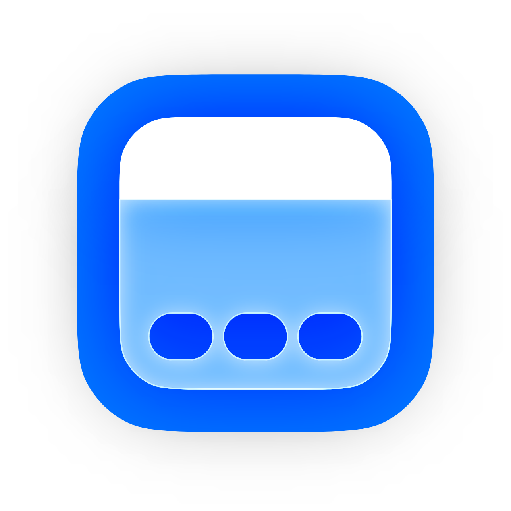

<p align="center">
  
</p>

# Class Plus Plus（Classpp / Class++）

**一款简洁高颜值的安卓课表 App，集课表、日程与待办于一体。**

> 当前版本：`v1.0.0-beta` · 最低支持 Android 7.0（API 24） · 单 Activity + 100% Kotlin / Jetpack Compose

起初这只是一份设计稿，装着作者对「安卓端简洁好看的课表 App」的全部幻想。在 Vibe Coding 工具的帮助下，这些想法被一点一点变成了现实——现在它不只是一张课表，而是把上课、安排日程和完成任务放在同一处的学习生活工作台。

---

## 功能亮点

### 课表：一眼看清这周上什么

- 周课表网格视图，支持单双周 / 交替周等排课规则，可自定义节次时间方案
- 课程详情、临时调课、课程颜色与教师显示偏好都能按自己的习惯调整
- 多种导入方式：手动编辑、文本粘贴、图片或文字交给 AI 识别，以及学校教务同步
- 支持 Wakeup 口令导入与拾光教务适配脚本；学校适配可按声明接入，无需改客户端代码
- 「今日课程」桌面小组件（4×2），抬眼就知道下一节在哪

### 日程：把日子过成自己喜欢的样子

- 按天浏览课程与安排，配大字号日期、节日与节气标记
- 日程背景图、图片网格与卡片动效，兼顾信息和观感
- 待办可写入系统日历，也可加入系统闹钟；到点通知与开机后自动重排提醒

### 待办：从收集到完成的一条线

- 分组、标签、置顶、归档与最近删除，支持列表视图和收集箱视图
- 截止时间、重复规则、步骤清单、附件、地点与打卡进度
- 待办概览提供今日收工统计与周节奏图表，侧滑即可快速处理卡片
- 支持通过分享码导入 / 导出待办内容

### 更多细节

- **AI 助手**：自带工具调用，能读写课表与待办；支持 OpenAI 兼容与 Anthropic 协议、多家预设服务与自定义端点，API Key 由 Android Keystore 加密保存
- **高颜值界面**：毛玻璃、液态玻璃底栏、连续曲率形状、自研动效与深浅主题；颜色 / 间距 / 字号均由设计 token 统一管理
- **本地优先**：课表、待办、标签等默认保存在设备本地；提供未加密 ZIP 备份与恢复
- **中英双语**：界面文案支持中文与英文

---

## 快速开始

### 环境要求

- 最新版 Android Studio，安装 Android SDK Platform 37 与 build-tools
- JDK：Gradle 守护进程按 `gradle/gradle-daemon-jvm.properties` 使用 JDK 25，项目配置了 Foojay 工具链解析器，可自动获取
- 构建一个 `:app` 单模块即可，无需额外后端服务

### 构建与验证

```bash
git clone https://github.com/ChengFY0710/Classpp.git
cd Classpp

./gradlew :app:assembleDebug          # 构建 Debug APK
./gradlew :app:testDebugUnitTest      # 运行 JVM 单元测试
./gradlew :app:assembleRelease        # 构建经过 R8 优化的 Release APK
```

Windows 下把 `./gradlew` 换成 `gradlew.bat`。产物位于 `app/build/outputs/apk/`。需要核对 Compose 编译产物时，可加 `-PcomposeCompilerReports` 参数生成可跳过性报告。

---

## 技术栈

| 维度 | 选型 |
|---|---|
| 语言 / UI | Kotlin + Jetpack Compose + Material 3，单 Activity |
| 架构 | 手写依赖容器 `AppContainer` + Repository + `StateFlow`，无 ViewModel、无 Navigation-Compose |
| 持久化 | JSON 文件存储 + SharedPreferences；敏感凭据走 Android Keystore AES-256/GCM |
| 网络 | OkHttp 5（原生接口与 AI SSE）+ 无头 WebView（会话型学校站点） |
| 视觉 | Haze 毛玻璃、Kyant0 Shapes / Backdrop、Coil 3、Glance AppWidget |
| 构建 | Gradle 9.6 + AGP 9.4 + Kotlin 2.4，Version Catalog 统一管理依赖 |
| 测试 | JUnit 4，Fake 注入 + 契约测试 + 静态守卫测试 |

详细选型理由、架构决策与已知技术债见 [docs/技术栈.md](docs/技术栈.md)。

### 代码结构

```text
app/src/main/java/com/fangyi/classpp/
├── MainActivity.kt          # 唯一入口，承载页面与浮层
├── ui/                      # 页面与组件
│   ├── day/ schedule/ note/ settings/ schools/ ai/
│   ├── components/          # 跨页卡片、浮层、选择器
│   ├── motion/ navigation/  # 自研动效与 TabPager 导航
│   └── theme/               # 颜色、间距、形状、字体等设计 token
├── data/                    # Repository、Store、同步引擎、通知、AI、备份等
├── schools/<id>/            # 一校一包的适配层
└── widget/                  # 今日课程小组件
docs/                        # 技术栈、学校适配与视觉规范
```

### 项目文档

- [技术栈与架构决策](docs/技术栈.md)
- [学校适配指南](docs/学校适配指南.md)
- [颜色使用规范](docs/颜色使用规范.md) · [间距使用规范](docs/间距使用规范.md) · [字体使用规范](docs/字体使用规范.md)
- [贡献与开发约定](docs/AGENTS.md)

---

## 隐私与权限

课表、待办、标签、日程背景图与 AI 对话等数据默认保存在本机，项目不内置统计或崩溃上报 SDK；账号密码与 API Key 经 Keystore 加密保存。部分能力需要联网或系统权限：

- AI 对话会把聊天内容、图片以及课表 / 待办上下文发往你选择的第三方 AI 服务商
- 教务同步、Wakeup 导入与远端学校列表会访问对应的第三方服务
- 日历 / 闹钟 / 通知权限仅用于待办提醒；应用内更新需要安装未知应用的授权
- 手动导出的备份是**未加密 ZIP**，请自行妥善保管

完整说明见 [DISCLAIMER.md](DISCLAIMER.md)。

---

## 免责声明

本项目为纯 Vibe Coding 个人开源项目，未经安全审计，按"现状"提供。**使用本项目的任何安全风险及后果均由您自行承担，作者概不负责。** 使用前请完整阅读 [DISCLAIMER.md](DISCLAIMER.md)，不同意请勿使用。

请注意：AI 对话会将聊天内容、图片以及课表/待办等上下文发送至你选择的第三方 AI 服务商；教务同步、Wakeup 导入与远端学校列表也会访问对应第三方服务。导出备份为未加密 ZIP，请自行妥善保管。

---

## 协议

本项目采用 [PolyForm Noncommercial License 1.0.0](https://polyformproject.org/licenses/noncommercial/1.0.0) 发布，完整条文见 [LICENSE](LICENSE)。

+ 允许任何**非商业目的**的使用、修改与分发（个人学习、研究、爱好项目、非营利组织等均属非商业用途）；
+ **禁止**将本项目（含基于本项目的修改版、衍生作品）用于任何商业用途。

Copyright (c) 2026 ChengFY

本项目依赖的第三方组件（haze、Cresto、Shapes、AndroidX、kotlinx.serialization 等）均遵循其各自的 Apache-2.0 协议。

---

如您发现本项目存在任何侵权情形，请及时与我联系；一经核实，将立即移除本项目相关内容。

---

## 致谢：

https://github.com/chrisbanes/haze

https://github.com/Nevodev/Cresto

https://github.com/Kyant0/Shapes

https://github.com/Kyant0/AndroidLiquidGlass

https://github.com/coil-kt/coil

https://github.com/mikepenz/multiplatform-markdown-renderer

https://gitee.com/XingHeYuZhuan-gh/shiguang_warehouse （Wakeup 口令与拾光教务导入适配脚本来源）
